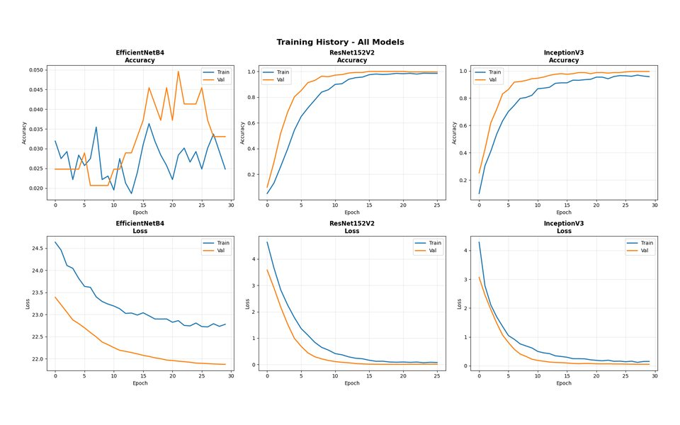

# Palmprint authentication

Identifies a person from a phone photograph of their palm. The pipeline finds the palm, crops the region that carries the most stable lines, enhances its contrast, and classifies it with fine-tuned ImageNet networks.

## Pipeline

1. **Load.** Birjand University Mobile Palmprint Database (BMPD): 1,612 photographs of both hands from 41 people, taken in two sessions.
2. **Region of interest.** Otsu threshold and morphology to find the hand contour, then a crop of the central palm, resized to 224 x 224.
3. **Enhance.** CLAHE contrast enhancement, cached to disk so training does not repeat it.
4. **Split.** 70 / 15 / 15 by image within each person: 1,128 training, 242 validation and 242 test images, with all 41 people in every split.
5. **Train.** Three transfer-learning models with augmentation, learning-rate reduction on plateau and early stopping: EfficientNetB4, ResNet152V2 and InceptionV3.
6. **Ensemble.** Average the class probabilities of the models.

## Results

On the 242 held-out test images:

| Model | Test accuracy |
| --- | --- |
| ResNet152V2 | 100.00% |
| InceptionV3 | 98.76% |
| EfficientNetB4 | 3.31% |
| Ensemble (probability average) | 99.59% |

EfficientNetB4 did not train in this setup; it stayed near chance, as its curve shows. The ensemble result is carried by the other two networks.

## Limits

- This is closed-set identification: every person in the test set also appears in the training set, and the split is by image, not by session. Accuracy on a new capture session, or rejection of people who were never enrolled, is not measured here.
- 41 people is a small population. The result does not transfer to a large enrolment without retesting.

## Run it

The notebook was written for Kaggle with a GPU.

1. Add the BMPD dataset to the notebook (it expects it under `/kaggle/input/birjand-university-mobile-palmprint-databasebmpd`), or change `BASE` in the "Loading Dataset" cell to a local copy.
2. Run `palmprint_authentication.ipynb` from top to bottom.

Main dependencies: TensorFlow / Keras, OpenCV, scikit-learn, pandas, matplotlib, seaborn.

The dataset and the trained weights are not stored in this repository. Sample palm photographs have been removed from the notebook output because they are biometric images of real people.

## Author

Muhammad Umer Khan, [Neurals Solutions](https://neuralssolutions.com)

## License

MIT. See [LICENSE](LICENSE).
